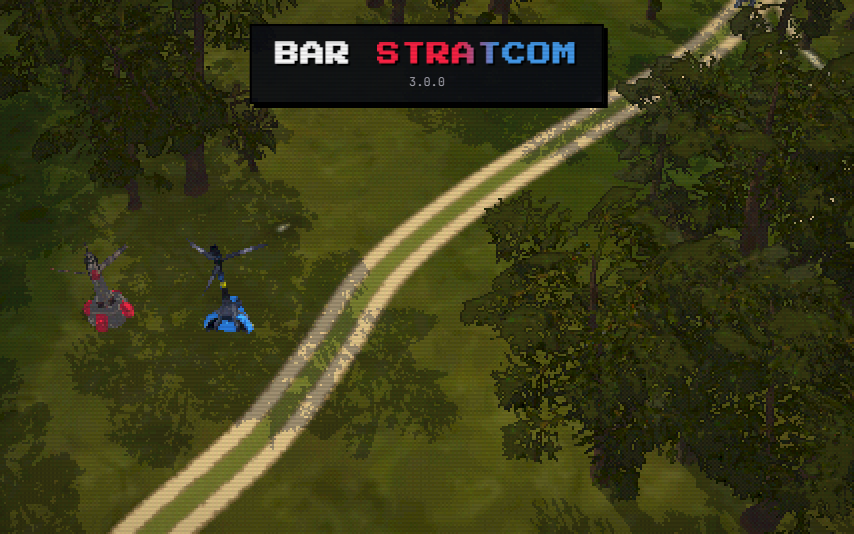
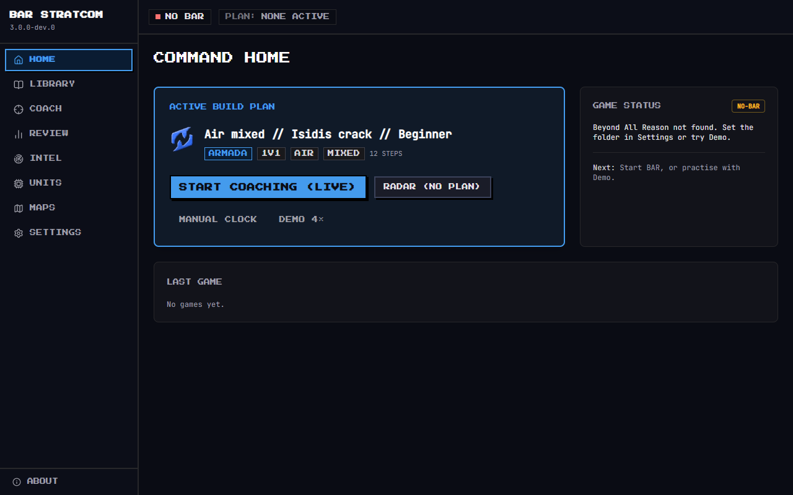
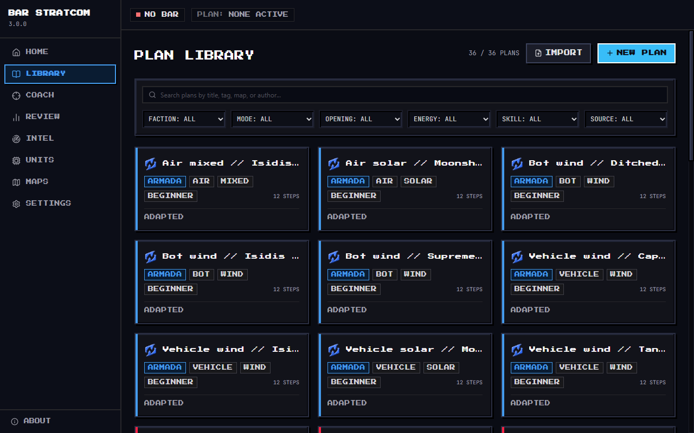
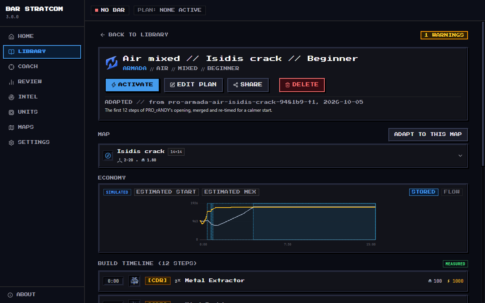
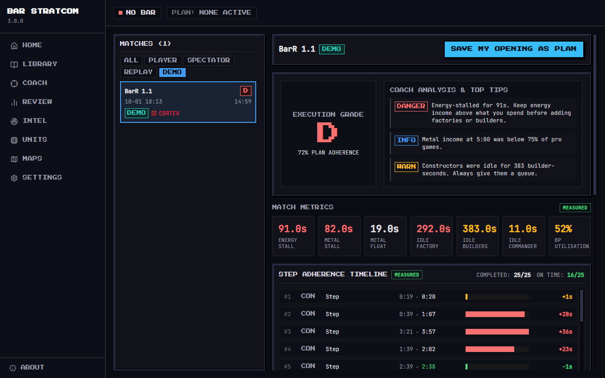

<h1 align="center">BAR StratCom</h1>

<p align="center">
  <b>A live build-order coach for <a href="https://www.beyondallreason.info/">Beyond All Reason</a>.</b><br>
  It shows your next build in the game, warns you when your economy stalls, and reviews every game.
</p>

<p align="center">
  <a href="https://github.com/GrantVRP/BAR-Stratcom/releases"><b>⬇ Download for Windows</b></a>
  &nbsp;&nbsp;·&nbsp;&nbsp;
  <a href="docs/user-guide.md">User guide</a>
  &nbsp;&nbsp;·&nbsp;&nbsp;
  <a href="CHANGELOG.md">What's new</a>
</p>

<p align="center">
  
</p>

> [!NOTE]
> **Unofficial community tool.** BAR StratCom is not affiliated with or endorsed by the Beyond All
> Reason team.

## What it does

- **Coaches you live.** The in-game panel shows what your commander, constructors and factories build
  next, the enemies your team sees, and the most urgent warning. Steps tick off as buildings finish.
- **Gives you plans you can trust.** The curated openings come from real high-level games and name the
  replay and player. Adapt one to a map's wind, edit and share it, or draft one with your own AI model.
- **Reviews every game.** A grade, the top three tips, stall and idle times, and your income against
  pro games. Save your own opening, or any player's from a replay, as a new plan.
- **Works without the game.** Demo mode coaches a recorded real game, so you can try everything first.
  Manual Clock covers lobbies that disable user widgets.

<table>
  <tr>
    <td width="50%" valign="top">
      
      <br><sub><b>Home</b>: your active plan and one button to start coaching.</sub>
    </td>
    <td width="50%" valign="top">
      
      <br><sub><b>Library</b>: filter plans by faction, mode, opening, energy, skill and source.</sub>
    </td>
  </tr>
  <tr>
    <td width="50%" valign="top">
      
      <br><sub><b>Plan</b>: where it came from, its simulated economy and every step.</sub>
    </td>
    <td width="50%" valign="top">
      
      <br><sub><b>Review</b>: a grade, the top three tips and each step's timing.</sub>
    </td>
  </tr>
</table>

## Get started

You need Windows 10 or 11 (64-bit). Beyond All Reason is needed for live coaching only.

### 1. Install

1. Download `BAR StratCom-<version>-win-x64.zip` from the
   [releases page](https://github.com/GrantVRP/BAR-Stratcom/releases).
2. Unzip it into any folder and run `BAR StratCom.exe`. There is no installer.
3. The app is not code-signed, so Windows may say it protected your PC: choose **More info → Run
   anyway**.

### 2. First run

A short setup wizard finds your BAR folder, installs the widget, asks for your skill level and lets you
pick a plan or watch a demo. Then, in BAR, enable **BAR StratCom** once in the widget list (**F11**)
and start a match: coaching starts with it. **Ctrl+Alt+S** shows or hides the coach window.

### 3. Learn the rest

The [user guide](docs/user-guide.md) covers plans, the coaching modes, alerts and skill profiles, the
in-game assist keys, reviews, AI drafting, and
[what to do for each status](docs/user-guide.md#troubleshooting-by-health-state).

### Updating

The app tells you when a newer release is out (Settings → App turns this off). Unzip the new release
into a fresh folder and delete the old one: your settings, plans and games live in
`%APPDATA%\bar-stratcom` and stay. Then update the widget when the top bar shows **WIDGET UPDATE**.

## Privacy

BAR StratCom collects no data: no accounts, no analytics, no telemetry. Your plans, games and settings
stay on your PC. The app goes online only to check for a new release (you can turn this off), to show
the public Intel hub and map pictures, and to reach the AI provider you chose, if any.
[Details](docs/privacy.md).

## For developers

You need Node.js 24 (`.nvmrc`) on Windows.

```text
npm ci
npm run dev         # the app with hot reload
npm run verify      # type checks, lint, data checks, unit and widget tests, build, end-to-end tests
npm run package     # release/BAR StratCom-<version>-win-x64.zip
```

<details>
<summary><b>Project layout</b></summary>
<br>

| Folder | What it holds |
| --- | --- |
| `src/core` | The game-independent logic: data schemas, plan validation, the economy simulator, the coach, post-game analysis. No Electron, no Node. |
| `src/main` | The Electron main process: game locator, widget installer, file bridge, coach runner, recorder, AI providers, settings. |
| `src/preload`, `src/shared` | The validated IPC bridge and its contract. |
| `src/renderer` | The React interface. |
| `widget` | The in-game Lua widget and its tests (run in a Lua VM against a model of the engine). |
| `data` | Unit data exported from the game, maps, wind tables, curated plans, benchmarks and recorded games for the demo. |
| `tools` | Data import, curation, checks, packaging helpers. |
| `tests/e2e` | Playwright tests against the built app. |

</details>

## Licences and credits

BAR StratCom is released under the [MIT licence](LICENSE). The in-game widget is
[GPL-2.0-or-later](widget/LICENSE). The packages, fonts and art the app ships with are listed in
[THIRD_PARTY_NOTICES.md](THIRD_PARTY_NOTICES.md).

### Credits

- **Unit art:** 32-bit pixel versions of the Beyond All Reason unit icons by **IceXuick and Floris**,
  used with permission. The originals are © IceXuick and Floris
  (CC BY-NC-ND, `/unitpics/` in the Beyond All Reason repository). The pixel versions are made by
  `tools/pixelate-unitpics.ts` and live in `src/renderer/src/assets/unitpics-32/`.
- **Faction emblems:** 32-bit versions of the Beyond All Reason faction icons (`sidepics/`), used with
  permission. Made by `tools/pixelate-factions.ts`, in `src/renderer/src/assets/factions-32/`.
- **Launch scene:** pixel art built from the Greenest Fields map by **IceXuick** (map texture from
  beyondallreason.info), used with permission. Made by `tools/build-launch-scene.ts`, in
  `src/renderer/src/assets/launch/`.
- **Launch scene 3D:** Sprinter model by FireStorm and PtaQ; Fiend model by Beherith and PtaQ; the
  Armada and Cortex wind turbines and wrecks; Aleppo pines by Beherith and 0 A.D.; walk and death
  animations by Beherith; explosion effects from Beyond All Reason;
  Cortex texture by Beherith; Armada texture by Cremuss (CC BY-SA 4.0, the restyled copy is shared under
  the same licence). Made by `tools/build-launch-3d.ts`, in `src/renderer/src/assets/launch3d/`.
- Unit data comes from each player's own game through the StratCom widget. Beyond All Reason is made
  by its community: https://www.beyondallreason.info/
- BAR StratCom is an unofficial community tool and is not affiliated with the Beyond All Reason team.
