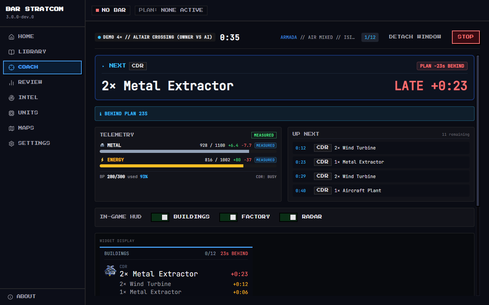

# BAR StratCom

A live build-order coach for [Beyond All Reason](https://www.beyondallreason.info/). A small widget in
the game and a desktop app for Windows follow your game together: they show the next step of your
opening, warn you when your economy stalls or your builders stand idle, and review the game afterwards.

> **Unofficial community tool.** BAR StratCom is not affiliated with or endorsed by the Beyond All
> Reason team.



## What it does

- **Coaches you live.** The in-game panel shows what your commander and constructors build next, what
  your factories should produce, a radar of the enemies your team sees, and the most urgent warning.
  Steps tick off as your buildings finish; alerts come from your real economy, with sounds if you want
  them.
- **Gives you plans you can trust.** The curated library comes from real high-level games, and every
  plan names the replay and player it was taken from. Adapt a plan to a map's wind, edit it, share it
  as a code or a Discord message, or draft one with an AI model you bring yourself.
- **Reviews every game.** A grade, the top three tips, stall and idle times, each step's timing, and
  how your income compares with pro games. Save your own opening, or any player's from a replay, as a
  new plan.
- **Works without the game.** Demo mode coaches a recorded real game, so you can try everything
  first. Manual Clock covers lobbies that disable user widgets.
- **Collects nothing.** No accounts, no analytics, no telemetry. See [privacy](docs/privacy.md).

| | |
| --- | --- |
|  |  |
|  |  |

## Install

You need Windows 10 or 11 (64-bit). Beyond All Reason is needed for live coaching only.

1. Download `BAR StratCom-<version>-win-x64.zip` from the
   [releases page](https://github.com/GrantVRP/BAR-Stratcom/releases).
2. Unzip it into any folder and run `BAR StratCom.exe`. There is no installer.
3. The app is not code-signed, so Windows may say it protected your PC: choose **More info → Run
   anyway**.

The app tells you when a newer release is out (Settings → App turns this off). To update, unzip the new
release into a fresh folder and delete the old one: your settings, plans and games live in
`%APPDATA%\bar-stratcom` and stay. Then update the widget when the top bar shows **WIDGET UPDATE**.

## First run

A short setup wizard finds your BAR folder, installs the widget, asks for your skill level and lets you
pick a plan or watch a demo. Then, in BAR, enable **BAR StratCom** once in the widget list (**F11**)
and start a match: coaching starts with it. **Ctrl+Alt+S** shows or hides the coach window.

The [user guide](docs/user-guide.md) covers everything else: plans, the coaching modes, alerts and
skill profiles, the in-game assist keys, reviews, AI drafting, and
[what to do for each status](docs/user-guide.md#troubleshooting-by-health-state).

## Privacy

BAR StratCom collects no data. Your plans, games and settings stay on your PC. The app goes online only
to check for a new release (you can turn this off), to show the public Intel hub and map pictures, and
to reach the AI provider you chose, if any. [Details](docs/privacy.md).

## Build from source

You need Node.js 24 (`.nvmrc`) on Windows.

```text
npm ci
npm run dev         # the app with hot reload
npm run verify      # type checks, lint, data checks, unit and widget tests, build, end-to-end tests
npm run package     # release/BAR StratCom-<version>-win-x64.zip
```

| Folder | What it holds |
| --- | --- |
| `src/core` | The game-independent logic: data schemas, plan validation, the economy simulator, the coach, post-game analysis. No Electron, no Node. |
| `src/main` | The Electron main process: game locator, widget installer, file bridge, coach runner, recorder, AI providers, settings. |
| `src/preload`, `src/shared` | The validated IPC bridge and its contract. |
| `src/renderer` | The React interface. |
| `widget` | The in-game Lua widget and its tests (run in a Lua VM against a model of the engine). |
| `data` | Unit data exported from the game, maps, wind tables, curated plans, benchmarks and recorded games for the demo. |
| `tools` | Data import, curation, checks, packaging helpers. |
| `tests/e2e` | Playwright tests against the built app. |

The design is in [docs/plan/02-architecture.md](docs/plan/02-architecture.md); the whole plan starts
at [docs/plan/README.md](docs/plan/README.md). Changes are in the [changelog](CHANGELOG.md).

## Licences

BAR StratCom is released under the [MIT licence](LICENSE). The in-game widget is
[GPL-2.0-or-later](widget/LICENSE). The packages, fonts and art the app ships with are listed in
[THIRD_PARTY_NOTICES.md](THIRD_PARTY_NOTICES.md).

## Credits

- **Unit art:** 32-bit pixel versions of the Beyond All Reason unit icons by **IceXuick and Floris**,
  used with permission. The originals are © IceXuick and Floris
  (CC BY-NC-ND, `/unitpics/` in the Beyond All Reason repository). The pixel versions are made by
  `tools/pixelate-unitpics.ts` and live in `src/renderer/src/assets/unitpics-32/`.
- **Faction emblems:** 32-bit versions of the Beyond All Reason faction icons (`sidepics/`), used with
  permission. Made by `tools/pixelate-factions.ts`, in `src/renderer/src/assets/factions-32/`.
- **Launch scene:** pixel art built from the Greenest Fields map by **IceXuick** (map texture from
  beyondallreason.info), used with permission. Made by `tools/build-launch-scene.ts`, in
  `src/renderer/src/assets/launch/`.
- **Launch scene 3D:** Sprinter model by FireStorm and PtaQ; Fiend model by Beherith and PtaQ; the
  Armada and Cortex wind turbines and wrecks; Aleppo pines by Beherith and 0 A.D.; walk and death
  animations by Beherith; explosion effects from Beyond All Reason;
  Cortex texture by Beherith; Armada texture by Cremuss (CC BY-SA 4.0, the restyled copy is shared under
  the same licence). Made by `tools/build-launch-3d.ts`, in `src/renderer/src/assets/launch3d/`.
- Unit data comes from each player's own game through the StratCom widget. Beyond All Reason is made
  by its community: https://www.beyondallreason.info/
- BAR StratCom is an unofficial community tool and is not affiliated with the Beyond All Reason team.
